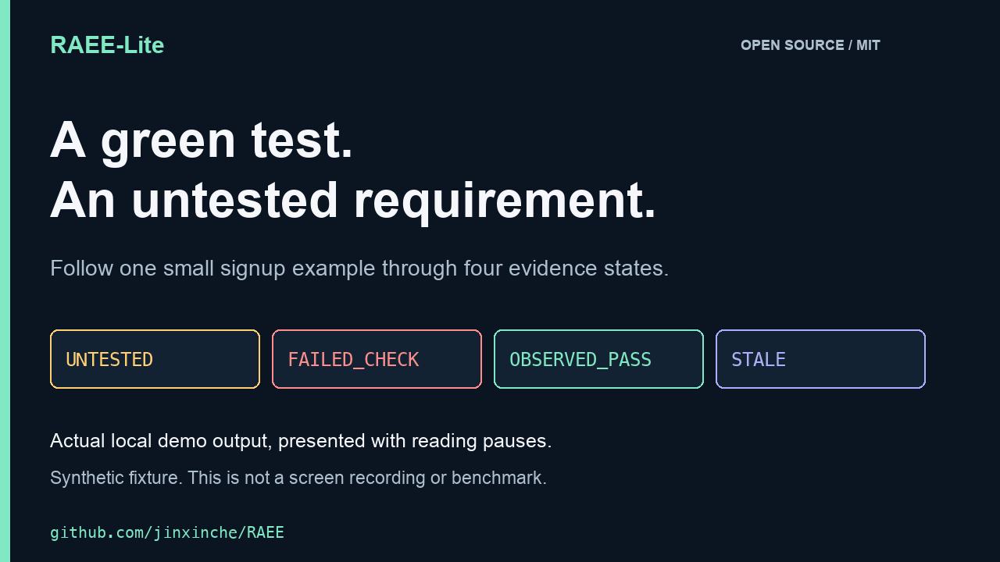

# RAEE-Lite

**Track what your AI coding agent actually tested.**

> Your coding agent wrote the code. RAEE-Lite helps you see what was actually checked—and what remains unproven.

A local Python CLI that links requirements to recorded checks, flags stale evidence after source changes, and produces reports for code review.

[English](README.md) · [简体中文](docs/README.zh-CN.md) · [Deutsch](docs/README.de-DE.md) · [Español](docs/README.es-ES.md)

**Release:** `v0.10.0rc2` candidate · **License:** MIT · **Python:** 3.10+ · **No AI API key required for core offline checks**

[Run the demo](examples/DEMO.md) · [Install](#try-the-public-release-candidate) · [Read a concrete example](docs/green-tests-not-verified-requirements.md) · [Share feedback](https://github.com/jinxinche/RAEE/issues/7)

### See the difference

For developers using coding agents and reviewers asking what a change actually tested:

| Situation | What RAEE-Lite makes visible |
| --- | --- |
| An unrelated smoke test passes | The requirement still has no matching receipt: `UNTESTED` |
| A linked test fails | The recorded check failed: `FAILED_CHECK` |
| The linked test passes after a fix | A labelled command passed: `OBSERVED_PASS` |
| Source changes after that check | The old result no longer applies: `STALE` |



[40-second video](docs/assets/launch/raee-demo-40s.mp4) · [Static transcript and reproduction](examples/DEMO.md) · [Media details and subtitles](docs/assets/launch/README.md)

The animation replays real local output from a synthetic fixture with added reading pauses; it is not a screen recording or timing benchmark.

This is the path taken by the [runnable synthetic demo](examples/DEMO.md), not the complete state machine. Requirement links and check kinds are supplied by the user; RAEE-Lite does not infer semantic test coverage. `OBSERVED_PASS` is not proof that a feature is correct.

### Try the public release candidate

**Status: public source release candidate, not a stable or security-certified release.** Core checks run locally without an AI API key. Independent provenance verification and branch-protection acceptance remain separate release gates.

Try it from a **disposable Python environment**, after inspecting the source:

```bash
git clone https://github.com/jinxinche/RAEE.git
cd RAEE
python -m venv .venv
```

Activate the environment with `source .venv/bin/activate` on macOS/Linux, or `.venv\Scripts\Activate.ps1` in PowerShell. If activation is unavailable, use `.venv/bin/python` or `.venv\Scripts\python.exe` in place of `python` below.

```bash
python -m pip install --no-deps .
python -m raee_lite --version
python examples/run_demo.py
```

The demo runs tiny, inspectable standard-library tests in a temporary project and removes it afterward. It needs no `pytest`, AI service, or private agent logs. [Expected output and explanations](examples/DEMO.md).

To inspect a project without executing its tests, start in a fresh, disposable project directory:

```bash
raee-lite init
raee-lite add "Signup rejects invalid email addresses"
raee-lite expect --for R1 --kind unit
raee-lite status
raee-lite check
```

**Expected:** `R1: UNTESTED` and an evidence-gap report. `status` intentionally returns exit code 1 while the requirement has no matching verification evidence; this is not a crash. The nonexecuting `check` command does not run repository-owned tests.

**What makes it useful:** Coding agents' statements, changed files, executed checks and unresolved requirements are *different evidence types*. RAEE-Lite keeps them separate rather than treating a green test as proof that a requested feature works.

[Reproduction details](examples/DEMO.md) · [Security boundaries](SECURITY.md) · [Early-access feedback](https://github.com/jinxinche/RAEE/issues/7) · [Engineering audit and pending release gates](docs/ENGINEERING_AUDIT_2026-11-05.md)

### New: proof-obligation trace (experimental)

`raee-lite trace --for R1 --json` emits a **read-only evidence graph** connecting user intent, each declared verification scope, its last self-labelled execution receipt, and source fingerprint relevance. Missing, stale, partial and failed scopes remain explicit; even an `OBSERVED_PASS` never becomes a semantic correctness proof. [Trace example and graph semantics](docs/PROOF_OBLIGATION_TRACE.md).

### What you get—and what you do not

| Observed evidence | What RAEE-Lite can report | What it cannot conclude |
| --- | --- | --- |
| Coding agent says a fix is done | Historical, **unverified** agent claim | That the code works |
| Files changed | Diff and source-state fingerprint | That the requirement was satisfied |
| Unit test returns exit 0 | Which test ran, on which source state | That the test covered the required behavior |
| Source modified after testing | Previously observed evidence becomes stale | That all hidden failures are detected |
| CI provenance signature verified | Authenticity of an attested claim | General absence of defects |

**Why this matters:** In AI-assisted coding, green tests are often mistaken for verified user intent. RAEE-Lite deliberately reports the **unverified gap** instead of manufacturing confidence.

[How the evidence model works](examples/EVIDENCE_CONTRACTS.md) · [Security boundaries](SECURITY.md) · [Contributing](CONTRIBUTING.md) · [Release review](docs/SOLO_MAINTAINER_VALIDATION.md)


## Why this project?

AI coding agents can generate, change, and test code quickly. But a successful command, a reassuring agent message, or a green checkmark does **not** necessarily establish that a user's requirement was fulfilled.

**RAEE-Lite** applies *role-aware evidence engineering* to software development. Instead of collapsing different signals into a single “verified” label, it keeps five evidence roles separate:

| Evidence role | Question | Boundary |
| --- | --- | --- |
| **Intent** | What did the user request? | A written requirement is not proof of implementation. |
| **Change** | What code and repository revision changed? | A diff does not prove correctness. |
| **Verification** | What checks actually ran, and what were their results? | An exit code of zero does not guarantee meaningful coverage. |
| **Environment** | Where and under which conditions were checks executed? | An environment description alone is not a trusted identity. |
| **Boundary** | What is missing, stale, excluded, or untested? | Unobserved behavior must not be represented as verified. |

## Intended workflows

The development candidate includes:

- **Read-only preflight checks** for repository and CI configuration risks.
- **Evidence contracts** connecting user-stated requirements to expected check categories.
- **Selected Codex / Claude Code log import**, with agent transcripts explicitly marked as historical, unverified evidence.
- **Local check recording** and source-state freshness detection.
- **Base/Head evidence comparisons** for pull-request review.
- **HTML, Markdown, JSON and SARIF reports**, plus optional isolated execution and provenance verification paths.

The design distinguishes **an agent's claim**, **a locally observed command**, and **an externally authenticated CI provenance statement**. None of these alone proves that software is free of defects.

## Getting started

**Publication status:** Install from a reviewed checkout of this repository. This remains a release candidate; no stable release, independently verified provenance or PyPI publication is claimed.

After installing a reviewed release candidate:

```bash
raee-lite preflight     # Read-only inspection
raee-lite doctor        # Discover plausible checks without executing them
raee-lite check         # Generate an evidence-gap report
```

The default workflow does not run project-owned scripts. Executing tests is an explicit opt-in and must be limited to code and environments you trust.

Concurrent CLI writers serialize receipt appends, requirement/contract edits,
transcript imports and evidence links. Keep `.raee/*.lock` files in place while
writers may be running. If an audit detects evidence changes during report
generation, let the writers finish and retry. Manual file edits and
network-filesystem locking are outside this validated concurrency boundary.

## Privacy and trust boundaries

- Imported agent logs are **untrusted input**, not instructions.
- The importer is designed to retain limited summaries, rather than raw prompts or terminal outputs. Sanitize logs before sharing them.
- Static checks and report generation are **not** security certification.
- Docker-based isolation is **not** a substitute for a hardened virtual machine or independently reviewed sandbox.
- A digital signature authenticates a statement's provenance; it does **not** prove that the statement or its tests are sufficient.
- Real-world Codex/Claude compatibility, cloud CI attestations, and independent security validation remain acceptance work—not completed guarantees.

## Research origin

RAEE-Lite takes inspiration from the **role-aware evidence organisation** principle proposed in a separate oncology AI research preprint:

> Hu, J., Jin, X., Song, Y., Chen, Z., & Xin, L. (2026). *Restricted Multimodal Oncology AI: Role-Aware Evidence Organisation and Cross-Domain Transfer Boundaries*. Research Square, preprint, version 1. DOI: [10.21203/rs.3.rs-10194336/v1](https://doi.org/10.21203/rs.3.rs-10194336/v1).

In that study, evidence roles are assigned to biological data sources before multimodal integration. **RAEE-Lite translates the principle of non-interchangeable evidence roles into a software-engineering workflow.** The preprint does **not** present or experimentally validate this coding tool, its security architecture, or its performance.

See [the research citation](REFERENCES.bib). If you use the software, cite the software repository separately from the research preprint.

## Roadmap and project status

The near-term priorities are branch-protection acceptance, authentic artifact attestations, consented real-world agent-log benchmarks, and external security review.

**Verified baseline (2026-11-09):** [PR #14](https://github.com/jinxinche/RAEE/pull/14) is merged at `555bc92094760cebaeab0587e8b210e98d454d2e`. Its [main-branch CI run](https://github.com/jinxinche/RAEE/actions/runs/42082362410) passed. Before merging, [all twelve matrix jobs and the regression gate](https://github.com/jinxinche/RAEE/actions/runs/42076872999) passed on `ecbd66e`: 741 tests collected per job, with eight explicit platform skips on Windows and zero skips elsewhere. These results belong to those commits, not every later revision.

See the [first engineering audit](docs/ENGINEERING_AUDIT_2026-11-05.md) and [follow-up audit](docs/ENGINEERING_FOLLOWUP_2026-11-06.md) for changes and limitations. Branch-protection acceptance and independent provenance verification remain pending. This is not a claim of production readiness.

The candidate's [trusted test workflow](.github/workflows/tests.yml) defines twelve regression jobs: Ubuntu Python 3.10–3.15; Windows and macOS Intel Python 3.10/3.15; macOS ARM64 Python 3.10/3.15. It adds Ubuntu 3.11–3.14 and both ARM64 jobs to the historical six-job matrix. Each job is configured to build and exercise an installed package, run the full regression gate and validate the synthetic corpus with `--require-exact`; a final gate requires every matrix job to succeed. Verify the completed run against the candidate's exact head commit in the PR Checks tab. The regression runner centrally maintains total and per-module minima; see [CONTRIBUTING](CONTRIBUTING.md) for commands that use those defaults.

Scoped evidence now fails closed when the bounded Python audit finds omitted local imports or cannot finish confidently. It never certifies dependency closure. See [the dependency audit policy](docs/DEPENDENCY_COMPLETENESS_AUDIT.md) for states and limits, and [CONTRIBUTING](CONTRIBUTING.md) for the reproducible development and package checks.

The current candidate also retains execution-time scope audits, treats dynamic-import aliases as uncertain, includes script sibling imports in the bounded audit, rejects ambiguous JSON, and tightens provider and running-session handling in imported logs. Signing parses and hashes the same captured input bytes; provenance verification uses a private read-only copy of the captured subject. Failed key generation retains partial files for inspection without risking deletion of another writer's replacement. These changes and their verification limits are recorded in the [engineering audit](docs/ENGINEERING_AUDIT_2026-11-05.md).

## Community discussion

Have a reproducible example of an AI agent claiming "done" without matching evidence? Join the [early-access feedback thread](https://github.com/jinxinche/RAEE/issues/7). Please share only minimal, sanitized examples.

Useful feedback includes the command you tried, your Python/OS version, the status you expected, and the status you observed. Start with the synthetic demo; no private project or conversation is needed.

For developers who wish to write about this project, see the [technical explainer](docs/green-tests-not-verified-requirements.md) and [multilingual community outreach guide](docs/COMMUNITY_OUTREACH_EARLY_ACCESS.md). The latter contains drafts, **not published posts or verified reach metrics**.

## Contributing and license

Issues, reproduction cases, accessibility improvements and translations are welcome. Please never submit credentials, private agent conversations, or proprietary code in a public issue.

The repository's software license is [MIT](LICENSE). The linked research preprint has its own publication license.
