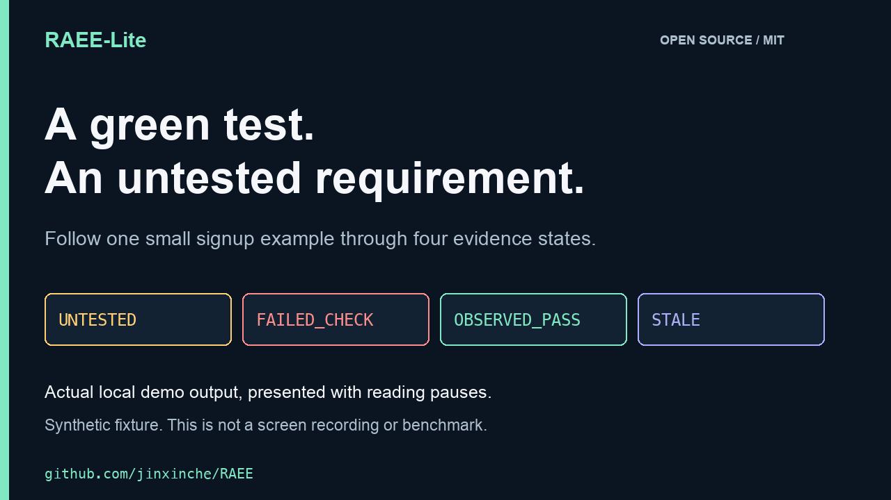

# RAEE-Lite：面向 AI 编程的角色感知证据工程

**让 AI 编程有证据，而不只是有“已完成”的回答。**

RAEE-Lite 是一个本地 Python 命令行工具：把需求和实际检查记录关联起来，在代码修改后标记过期证据，并生成供代码审查使用的报告。

[English](../README.md) · [简体中文](README.zh-CN.md) · [Deutsch](README.de-DE.md) · [Español](README.es-ES.md)

[运行演示](../examples/DEMO.md) · [安装说明](../README.md#try-the-public-release-candidate) · [反馈案例](https://github.com/jinxinche/RAEE/issues/7)

**公开候选版本已合入主干：** [main 分支源码](https://github.com/jinxinche/RAEE/tree/main) · [已合并的 PR #14](https://github.com/jinxinche/RAEE/pull/14) · [工程审计与验证边界](ENGINEERING_FOLLOWUP_2026-11-06.md)。目前仍为 `v0.10.0rc2` 候选版本，尚无稳定版、PyPI 正式发布或经独立验证的云端安全签名。

## 先看一个可运行的例子



[40 秒视频](assets/launch/raee-demo-40s.mp4) · [中文及英文字幕](assets/launch/README.md) · [静态文字版](../examples/DEMO.md)

这是合成示例的真实本地输出回放，加入了便于阅读的停顿；并非实时录屏或性能测试。

在 Python 3.10+ 虚拟环境中，从检查过的源码目录运行：

```bash
python -m pip install --no-deps .
python examples/run_demo.py
```

演示使用 Python 标准库，在自动清理的临时目录中执行小型合成测试；无需 AI API 密钥、`pytest` 或私人日志。实际展示四个状态：

| 场景 | 结果 |
| --- | --- |
| 无关的算术测试通过，尚无需求关联记录 | `UNTESTED`：需求未验证 |
| 给注册函数添加相关测试，发现错误 | `FAILED_CHECK`：检查失败 |
| 修复示例函数后，两项示例测试通过 | `OBSERVED_PASS`：观察到该命令通过 |
| 检查后再次修改源文件 | `STALE`：旧证据过期 |

需求关联和检查类别由用户指定；工具不会自动判断语义覆盖率。示例只检查邮箱中是否含有 `@`，并非生产级邮箱校验。详见[完整输出与说明](../examples/DEMO.md)。


## 为什么需要 RAEE-Lite？

Codex、Claude Code、Cursor 等 AI 编程工具可以快速修改代码，但“AI 声称已修复”“测试进程退出码为 0”“功能真实满足用户要求”是三件不同的事。

**RAEE-Lite** 将角色感知证据工程思想应用到软件开发，把原本容易混为一谈的证据拆分为五个互不替代的角色：

| 证据角色 | 要回答的问题 | 不应过度推断的内容 |
| --- | --- | --- |
| **意图证据** | 用户真正要求什么？ | 有需求描述不等于功能已经实现。 |
| **变更证据** | 哪些代码和提交发生变化？ | 代码差异不等于正确性证明。 |
| **验证证据** | 实际执行了哪些检查？结果如何？ | 测试通过不意味着需求得到充分覆盖。 |
| **环境证据** | 在什么环境和条件下运行？ | 环境信息不自动构成可信身份。 |
| **边界证据** | 哪些部分缺失、过期或未验证？ | 没测过的行为不能标为已验证。 |

## 工具的设计能力

开发候选版本包含只读仓库预检查、需求与检查类别关联、部分 Codex / Claude Code JSONL 日志导入、代码版本指纹、验证记录、PR 前后证据差异，以及 HTML / Markdown / JSON / SARIF 报告。

Agent 历史日志只作为**未经独立验证的会话证据**；本地实际执行和可信 CI 来源证明也分别记录，不能相互替代。

## 最简使用方式

**发布状态提示：** 可从本仓库经过审查的源码安装候选版本。稳定版、PyPI 发布、受保护主分支验收和独立来源验证仍是单独的发布门槛。

在已安装经过审查的本地开发版本后：

```bash
raee-lite preflight   # 只读检查配置与 CI 风险
raee-lite doctor      # 发现可能的检查项，不执行项目代码
raee-lite check       # 生成证据缺口报告
```

默认不会执行项目脚本；主动执行检查时，应使用可信代码与受限环境。

## 隐私与安全边界

- Agent 日志是不可信输入，不是可执行指令；公开分享前必须脱敏。
- 退出码为 0 仅说明对应命令完成，不代表需求、测试质量或安全性得到证明。
- Docker 隔离不等同于经过安全认证的虚拟机沙盒。
- 证据签名可以帮助验证来源和完整性，但不能证明测试结论真实充分。
- 跨平台回归记录见 [PR #14](https://github.com/jinxinche/RAEE/pull/14)；真实用户日志兼容率、独立来源验证和安全审计仍需另行验证。

## 研究来源与预印本引用

本软件从另一项肿瘤多模态 AI 研究提出的 **Role-Aware Evidence Engineering（RAEE，角色感知证据工程）** 思想获得启发：

> Hu, J., Jin, X., Song, Y., Chen, Z., & Xin, L. (2026). *Restricted Multimodal Oncology AI: Role-Aware Evidence Organisation and Cross-Domain Transfer Boundaries*. Research Square，预印本 v1。[DOI: 10.21203/rs.3.rs-10194336/v1](https://doi.org/10.21203/rs.3.rs-10194336/v1)。

原研究强调：不同生物学证据来源承担不同角色，不能因为被融合就视为等价。RAEE-Lite 将这种**角色不可交换性与适用边界**的设计原则迁移到代码变更和软件验证中。

**注意：预印本没有开发或实验验证 RAEE-Lite。** 引用该研究是为了说明方法论来源，而不是证明这款开发工具已经得到论文验证。引用软件时也应单独引用 GitHub 仓库。另见 [BibTeX](../REFERENCES.bib)。

## 项目现状

截至 2026-11-09，[PR #14](https://github.com/jinxinche/RAEE/pull/14) 已合并为 `555bc92`，对应的[主干 CI](https://github.com/jinxinche/RAEE/actions/runs/42082362410) 已通过。合并前的[十二组跨平台检查](https://github.com/jinxinche/RAEE/actions/runs/42076872999)在 `ecbd66e` 上每组收集 741 项测试：Windows 每组 8 项明确的平台跳过，其余平台无跳过。验证结果仅适用于对应提交。

接下来的优先任务是主干保护验收、独立 Artifact Attestation 验证、授权的真实日志评测及外部安全审查。

许可证：[MIT](../LICENSE)。欢迎未来提交规范的复现案例、翻译改进和安全反馈，但不要在公开 Issue 中上传密钥或私人会话。
