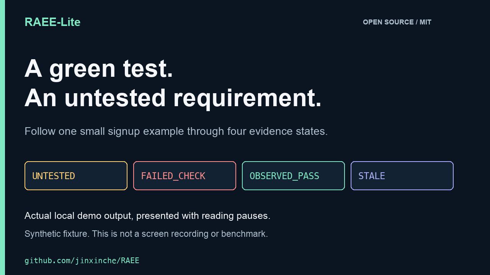

> Editorial hold: not submitted. DEV's [AI-content guidelines](https://dev.to/guidelines-for-ai-assisted-articles-on-dev) restrict promotion of programs and content primarily intended to grow a social presence. This AI-assisted launch draft should not be submitted there in its current promotional context. It remains an English technical draft for the owner's review and a suitable, explicitly chosen channel.

An arithmetic test can pass while a signup function still accepts every input. The test result is real; it simply does not answer the signup requirement.

That distinction is the starting point for [RAEE-Lite](https://github.com/jinxinche/RAEE), my open-source Python CLI for linking requirements to recorded checks and detecting when source changes make old results stale.

Here is a deliberately small example. The initial function is wrong:

```python
def signup(email):
    return True
```

A smoke test checks `1 + 1 == 2`. It passes without calling `signup`. Reporting that result as a verified email-validation feature would overstate what happened.

## Follow the recorded evidence

The repository includes a [runnable synthetic example](https://github.com/jinxinche/RAEE/blob/main/examples/DEMO.md). It creates a temporary project, runs standard-library tests, checks the resulting states, then removes the scratch files.



The animation is a 40-second replay of actual local output with reading pauses, not a screen recording or a benchmark. The capture records Python 3.11.16 on macOS ARM64 and source commit `4704dc85581fcbe5c4079196478ee8e8747abd24`; [capture details](https://github.com/jinxinche/RAEE/blob/main/docs/assets/launch/demo-provenance.json) accompany the media.

The captured output is:

```text
1. Unrelated arithmetic test passes
  R1: UNTESTED
2. A requirement-linked test exposes the bug
  R1: FAILED_CHECK
3. The toy fix passes the two example tests
  R1: OBSERVED_PASS
4. Source changes after the recorded check
  R1: STALE
```

`UNTESTED` means no matching receipt exists for this requirement and its declared check kind. It does not mean the tool read the arithmetic assertion and automatically understood that it was irrelevant.

Next, the example explicitly links a unit check to the signup requirement. That check calls the function with invalid and valid sample inputs. The always-true implementation fails, so the observed state becomes `FAILED_CHECK`.

The toy fix checks whether the input contains `@`. Its two example assertions pass, producing `OBSERVED_PASS`. This is intentionally a weak email validator: many invalid strings still contain `@`. A passing command and a correct requirement label do not make the assertions sufficient. The reviewer still has to examine that gap.

Finally, the example adds a source comment. The source fingerprint changes, so the previous result becomes `STALE`. This conservative freshness check does not try to prove that a comment is semantically harmless. It asks for a fresh observation against the changed source.

## Reproduce it locally

Review the source first, then clone it and create a disposable environment:

```bash
git clone https://github.com/jinxinche/RAEE.git
cd RAEE
python -m venv .venv
```

Activate with `source .venv/bin/activate` on macOS/Linux, or `.venv\Scripts\Activate.ps1` in PowerShell. Use Python 3.10 or later, then run:

```bash
python -m pip install --no-deps .
python examples/run_demo.py
```

The example needs no `pytest`, model API key or private agent transcript. It does execute the small synthetic tests in its temporary project. The separate `raee-lite check` inspection command does not execute project tests by default.

## What I would like feedback on

RAEE-Lite is a `v0.10.0rc2` source release candidate under the MIT license. It is not a stable package, a correctness prover or an independent security certification. Requirement links and check kinds remain user-supplied labels.

The useful next step is to test whether these distinctions help during review. Is a missing check easy to find? Is freshness too conservative for your workflow? Can you construct a small example where the reported state is misleading?

The [feedback issue](https://github.com/jinxinche/RAEE/issues/7) accepts minimal reproductions with OS/Python details and expected versus observed behavior. Synthetic examples are enough; do not post private code, credentials or raw agent conversations.

*Disclosure: prepared with AI assistance. The displayed demo output was checked against the saved local run; the recorded observations do not establish comprehensive test coverage.*
